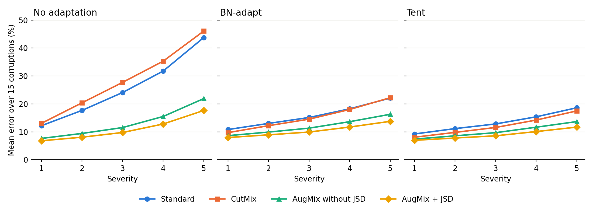
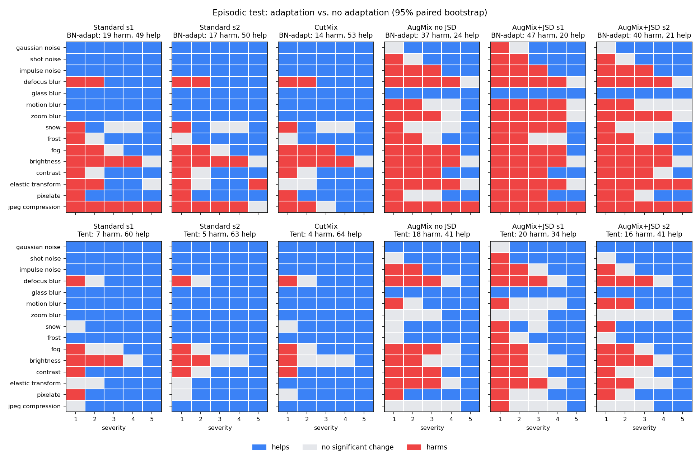

# Does Augmentation Make Test-Time Adaptation Safer?

**Authors:** Kirtan Patel and Yash Patel
**Course:** CMPE 252, Fall 2026
**Status:** Draft. Stage 2 sections (3.2, 4.3–4.6) are filled in; Discussion and Conclusion are still to be written together.

---

## Abstract

Image models do well on clean test pictures but make many more mistakes on damaged pictures, such as noisy, blurry or foggy ones. Two ways to fix this are training with augmentation and adapting the model at test time. We study how these two work together. We train a ResNet-18 on CIFAR-10 with Standard training, CutMix, AugMix without JSD and AugMix with JSD, and test each model on CIFAR-10-C with no adaptation, BN-adapt and Tent. AugMix + JSD has the lowest error, 11.01% without adaptation and 9.01% with Tent. But adaptation hurts AugMix models more often: in the episodic test, BN-adapt makes 49–63% of the conditions worse for AugMix models and 19–25% for Standard and CutMix. In a continual stream, Tent drifts on Standard and CutMix, and resetting it every 100 batches fixes this. So whether augmentation makes adaptation "safer" depends on what safer means.

## 1 Introduction

Deep image models such as ResNets [1] get more than 95% accuracy on CIFAR-10 [18]. But this only holds when the test pictures look like the training pictures. In real use, this is often not true. A car camera sees rain and fog, a scanner adds noise, and a web picture gets compressed. A person can still recognize these pictures, but a model can make many more mistakes [2].

CIFAR-10-C [2] measures this problem. It applies 15 kinds of damage at 5 severity levels to the CIFAR-10 test pictures, which gives 75 test conditions. The main rule is that a model must not train on these same kinds of damage.

There are two main ways to make a model stronger:

1. **Training-time defenses** change the training pictures. Examples are CutMix [4] and AugMix [5].
2. **Test-time defenses** change the model during use, with unlabeled test pictures. Examples are BN-adapt [6] and Tent [7].

Earlier work already shows that test-time adaptation still helps an augmentation-trained model, but the gain is smaller [6, 8]. The open question is about safety. Test-time adaptation can make a model worse. It can fail when the pictures keep changing [9, 10] or when batches are small [8, 11]. It can also hurt in some CIFAR-10-C conditions [12]. But these failure studies mostly use standard-trained models.

**Our question is: if a model was trained with augmentation, is test-time adaptation safer?**

To answer this, we train a ResNet-18 in 4 ways: Standard, CutMix, AugMix without its JSD loss, and AugMix with JSD. We then test all 6 trained models with no adaptation, BN-adapt and Tent. We use the standard episodic test and two harder tests: a continual stream and small batches. We measure error, harm rate, collapse and calibration.

**Our contributions are:**

- A fair comparison of 4 training methods, with one network, one set of training settings and one evaluation code.
- A check on ResNet-18 of how much Tent adds after BN-adapt for each model.
- A test of whether augmentation makes adaptation safer in continual and small-batch streams.
- A map of where adaptation helps or harms each model, and how it changes calibration.

**Our main finding is that the answer depends on what "safer" means.** AugMix + JSD has the lowest error, and Tent stays stable on it in the continual stream. But adaptation hurts AugMix models more often, usually by small amounts, because they are already good on clean pictures and mild damage. In the episodic test, BN-adapt harms 49–63% of the conditions for AugMix models and 19–25% for Standard and CutMix. CutMix has the best clean accuracy, but it does not protect the model in the continual stream.

## 2 Related Work

### 2.1 Benchmarks and Why Models Fail

Hendrycks and Dietterich [2] introduced CIFAR-10-C and ImageNet-C. RobustBench [3] gives standard leaderboards and pretrained models. Yin et al. [13] showed that augmentations that help with noise can hurt on fog and contrast. Mintun et al. [14] showed that an augmentation helps most on damage that looks like it. So a fair test must not train on edits that copy the test damage.

### 2.2 Training-Time Defenses

Mixup [15] blends two pictures and their labels. CutMix [4] pastes a box from one picture onto another and mixes the labels by area. AutoAugment [16] learns a set of picture edits, but its CIFAR-10 policy uses brightness and contrast, which are also CIFAR-10-C corruptions, so we do not use it. AugMix [5] mixes several chains of simple edits and adds a JSD loss, so the model gives similar answers for different versions of the same picture.

### 2.3 Test-Time Defenses

BN-adapt [6] replaces the stored batch normalization statistics with statistics from the test batch. Tent [7] also updates the BN scale and shift parameters to lower prediction entropy. CoTTA [9] studies long streams that keep changing. SAR [11] studies small batches and mixed shifts. RDumb [10] shows that regularly resetting the model is a strong baseline for long streams. Lowering entropy can also make a model over-confident, so we also measure calibration [17].

### 2.4 Closest Work

Three studies are closest to ours. Schneider et al. [6] applied BN-adapt to AugMix models and found a smaller gain for stronger models. TTAB [8] trained CIFAR-10 models with MixUp, AugMix and PixMix, and found that adaptation gives them only a small extra gain. Guha Majumdar and Saha [12] measured whether BN-adapt, Tent and EATA help or harm in each of the 75 CIFAR-10-C conditions, but only on a standard-trained model.

None of these studies tests whether augmentation-trained models make adaptation safer in continual or small-batch streams. Our project fills this gap.

## 3 Method

### 3.1 Stage 1: Training the Models

In Stage 1 we train the models that Stage 2 tests. Every model uses the same network and the same training settings. Only the training pictures and the loss change, so any difference comes from the training method.

**Data.** We train on the 50,000 CIFAR-10 training pictures [18]. Each picture is 32x32 and belongs to 1 of 10 classes. We check clean accuracy on the 10,000 CIFAR-10 test pictures. We only use the test accuracy to report results, not to pick a model. Each saved model is the model from the last epoch. We do not use CIFAR-10-C [2] in Stage 1.

**Model.** We use ResNet-18 [1], the version made for 32x32 pictures. It has about 11 million parameters and a batch normalization (BN) layer after each convolution. BN-adapt and Tent both need these BN layers. The model takes pictures with values from 0 to 1 and normalizes them inside, so Stage 2 can use it directly.

**Training methods.** All methods use random crop (padding 4) and random horizontal flip.

| Method | What it does | Loss |
|---|---|---|
| Standard | Crop and flip only | Cross-entropy |
| CutMix [4] | Pastes a box from one picture onto another and mixes the labels by area | Cross-entropy |
| AugMix without JSD [5] | Trains on one AugMix picture for each image | Cross-entropy |
| AugMix + JSD [5] | Uses the clean picture and 2 AugMix pictures, and asks the model to give the same answer for all 3 | Cross-entropy + 12 x JSD |

To make an AugMix picture, we make 3 edited copies. Each copy gets 1 to 3 random edits at severity 3. We mix the copies together, then mix the result with the original picture.

**Keeping the test fair.** The model must not train on the same changes it is tested on. So we use only 9 edits: autocontrast, equalize, posterize, rotate, solarize, shear x, shear y, translate x and translate y. We do not use brightness, contrast, color or sharpness, and a unit test checks this.

**Training settings.**

| Setting | Value |
|---|---|
| Epochs | 100 |
| Batch size | 128 |
| Optimizer | SGD, momentum 0.9, Nesterov |
| Learning rate | 0.1 with cosine decay |
| Weight decay | 0.0005 |
| Precision | Mixed precision (FP16) |
| CutMix | alpha = 1.0 |
| AugMix | 3 copies, 1–3 edits, severity 3, JSD weight 12 |

These are the AugMix default settings. We did not tune them for each method. We trained 6 models: 2 seeds for Standard, 2 seeds for AugMix + JSD, and 1 seed each for CutMix and AugMix without JSD.

### 3.2 Stage 2: Test-Time Adaptation

In Stage 2 we test the 6 models from Stage 1 on CIFAR-10-C [2]. CIFAR-10-C uses the same 10,000 test pictures as CIFAR-10, with 15 kinds of damage at 5 severities. It also comes with 4 extra kinds of damage (speckle noise, Gaussian blur, spatter and saturate). We use those 4 only to pick the Tent learning rate, never to report results.

**Adaptation methods.**

- **No adaptation.** The BN layers use the statistics stored during training.
- **BN-adapt [6].** Each BN layer [21] uses the mean and variance of the current test batch instead of the stored ones. No weights change.
- **Tent [7].** Tent also uses the test batch statistics, and it updates the BN scale and shift parameters to lower the entropy of the predictions. It takes one Adam [20] step per batch. All other weights stay fixed. The model predicts on a batch before it updates on that batch. Our Tent code follows the official code [7].

**Tent learning rate.** We tried 0.0001, 0.0003, 0.001 and 0.003 on the 4 extra kinds of damage at severity 5, with the public Standard WideResNet-28-10 [22] from RobustBench [3]. The error was 15.80%, 15.34%, 14.59% and 16.11%, so we kept 0.001, which is also the official value. For batches of 16 we scale it by 16/200, to 0.00008.

**Pipeline check.** Before testing our models, we tested the two public RobustBench models used in the Tent paper. At severity 5 our errors match the published numbers within 0.05 points for all 6 cases. For the Standard WideResNet-28-10 we get 43.51%, 20.44% and 18.58% for no adaptation, BN-adapt and Tent (published: 43.5, 20.4, 18.6). For the AugMix WideResNet-40-2 we get 18.27%, 14.49% and 12.08% (published: 18.3, 14.5, 12.1).

**Test protocols.** All 3 protocols use the same pictures. Only the order, the batch size and the resets change.

| Protocol | Pictures | Batch size | Reset to the trained model |
|---|---|---|---|
| Episodic | Clean, then the 75 conditions, 10,000 pictures each | 200 | Before each condition |
| Continual | The 15 kinds of damage at severity 5, one after another (Gaussian noise first, JPEG last), 150,000 pictures | 200 | Never |
| Small batch | The 15 kinds of damage at severity 5 | 16 | Before each condition |

The episodic protocol is the official Tent test. The continual protocol follows CoTTA [9], and the small-batch protocol follows the small-batch tests in [8, 11]. Continual Tent gives slightly different numbers each time it runs on a GPU, so we ran it 3 times for each model. We also ran episodic Tent at severity 5 with 3 different picture orders.

**Metrics.**

- **Error** on each condition.
- **ECE** [17] with 15 bins. It measures how far the model's confidence is from its accuracy.
- **Harm rate and help rate.** For each condition, we compare the adapted model with no adaptation on the same 10,000 pictures, using a paired bootstrap [19] with 1,000 resamples. A condition counts as harmed if the whole 95% interval of the error difference is above 0, and as helped if it is all below 0. The harm rate is the share of harmed conditions: out of 75 for the episodic test, and out of 15 for the severity-5 streams. We report the clean test set on its own.
- **Collapse score.** The largest share of one predicted class in any window of 1,000 predictions in a row. It is 0.1 when the predictions are balanced and 1.0 when every prediction is the same class. We report the largest value over the stream.

**Compute.** We ran Stage 2 on Kaggle T4 GPUs. The 22 runs for one model take about 40 minutes. Every prediction is saved, and all metrics are computed afterwards on a CPU.

## 4 Results

### 4.1 Clean Results

| Model | Seed | Clean accuracy | Clean error | Seconds per epoch | GPU hours | Where |
|---|---|---|---|---|---|---|
| Standard | 1 | 95.08% | 4.92% | 23.37 | 0.649 | Colab T4 |
| Standard | 2 | 94.97% | 5.03% | 20.84 | 0.579 | Colab T4 |
| AugMix + JSD | 1 | 95.21% | 4.79% | 141.58 | 3.933 | Colab T4, then Kaggle T4 |
| AugMix + JSD | 2 | 95.29% | 4.71% | 80.65 | 2.240 | Kaggle T4 |
| AugMix without JSD | 1 | 95.31% | 4.69% | 40.63 | 1.129 | Kaggle T4 |
| CutMix | 1 | 96.18% | 3.82% | 18.66 | 0.518 | Kaggle T4 |

All models reach about 95–96% clean accuracy. The two seeds are close: they differ by 0.11 points for Standard and 0.08 points for AugMix + JSD. CutMix is the best on clean pictures.

Stage 2 got the same clean error for 5 of the 6 models. AugMix + JSD seed 2 differs by one test picture (4.72% vs 4.71%). This shows the models were passed to Stage 2 correctly.

### 4.2 Corruption Results (RQ1 and RQ2)

This table shows the mean error over the 75 CIFAR-10-C conditions, using the episodic test with batch size 200. Standard and AugMix + JSD are the mean of 2 seeds.

| Model | Clean error, no adaptation | No adaptation | BN-adapt | Tent |
|---|---|---|---|---|
| Standard | 4.98% | 25.88% | 15.85% | 13.43% |
| CutMix | 3.82% | 28.50% | 15.33% | 12.22% |
| AugMix without JSD | 4.69% | 13.19% | 11.95% | 10.19% |
| AugMix + JSD | 4.76% | 11.01% | 10.45% | 9.01% |

**RQ1 and H1: which training method is best on corruptions?** AugMix + JSD has the lowest error, so H1 is supported. Both of its seeds (10.84% and 11.17%) beat every other model. CutMix is the best on clean pictures, but it is 2.61 points worse than Standard on corruptions.

**RQ2 and H2: how much does JSD help?** Removing JSD adds 2.18 points of error, which is close to the 2 points we expected. So H2 is supported, but AugMix without JSD has only 1 seed. Compared with Standard, AugMix + JSD lowers the error by 14.88 points. About 12.70 points come from the augmentation and 2.18 points come from JSD.

**Severity curves.** Without adaptation, the error of Standard and CutMix grows quickly as severity goes up. At severity 5, Standard has 43.74% error and AugMix + JSD has 17.64%. Adaptation makes the curves much flatter. At severity 1, adaptation makes AugMix + JSD a little worse (6.78% with no adaptation, 7.95% with BN-adapt and 6.96% with Tent). Tent helps it from severity 2, and BN-adapt helps it from severity 4.

**H5: which corruptions stay hard?** H5 is partly supported. Glass blur and noise stay among the hardest, but JPEG compression also joins the 5 hardest after adaptation. Contrast gets much easier for Standard (23.5% to 9.9% with BN-adapt). Fog improves less (11.4% to 9.4%), and BN-adapt makes fog slightly worse for AugMix + JSD (8.4% to 8.8%).

### 4.3 How Much Tent Adds After BN-adapt (RQ3)

This table uses the episodic test. "BN-adapt gain" is the error of no adaptation minus the error of BN-adapt. "Tent extra" is the error of BN-adapt minus the error of Tent. "BN-adapt share" is BN-adapt's part of the total gain. We show each model on its own, because the seeds behave differently in the next sections.

| Model | No adaptation (75) | BN-adapt gain | Tent extra | BN-adapt share | No adaptation (severity 5) | BN-adapt gain | Tent extra | BN-adapt share |
|---|---|---|---|---|---|---|---|---|
| Standard s1 | 25.90% | 10.08 | 2.55 | 80% | 43.64% | 21.63 | 3.62 | 86% |
| Standard s2 | 25.87% | 9.99 | 2.28 | 81% | 43.84% | 21.70 | 3.31 | 87% |
| CutMix | 28.50% | 13.17 | 3.11 | 81% | 46.07% | 23.86 | 4.73 | 83% |
| AugMix without JSD | 13.19% | 1.24 | 1.76 | 41% | 21.89% | 5.62 | 2.62 | 68% |
| AugMix + JSD s1 | 10.84% | 0.32 | 1.47 | 18% | 17.39% | 3.49 | 2.16 | 62% |
| AugMix + JSD s2 | 11.17% | 0.80 | 1.40 | 36% | 17.89% | 4.29 | 1.98 | 68% |

**Tent always adds something.** For every model, Tent is better than BN-adapt on 72–75 of the 75 conditions (95% paired bootstrap) and never worse. It is also better than BN-adapt on the clean test set, but still worse than no adaptation there.

**H3: most of the gain comes from BN-adapt, and Tent adds about 2 points.** The second half holds: Tent adds 1.4–3.1 points over all 75 conditions and 2.0–4.7 points at severity 5. That is about 2.4 points for Standard, 3.1 for CutMix and 1.4–1.8 for the AugMix models. On the public WideResNets, Tent added 1.86 (Standard) and 2.41 (AugMix) points at severity 5. The first half holds only for Standard and CutMix, where BN-adapt gives 80–87% of the gain. For the AugMix models, BN-adapt gives only 18–41% of the gain over all severities, and 62–68% at severity 5.

**Why AugMix is different.** At severity 1, BN-adapt makes every AugMix model worse than no adaptation, by 0.99 to 1.32 points. Tent wins back 0.98 to 1.23 points, but this fully makes up the loss only for AugMix without JSD (net +0.25 points). Both AugMix + JSD models stay slightly worse than no adaptation at severity 1 (net −0.32 and −0.04 points). For Standard and CutMix, BN-adapt already helps at severity 1, by 1.22 to 3.34 points.

**The total gain is much smaller for AugMix, as H3 expects.** Over all conditions it is 1.8–3.0 points for the AugMix models and 12.3–16.3 points for Standard and CutMix. At severity 5 it is 5.6–8.2 points against 25.0–28.6 points. AugMix + JSD is still the best model after adaptation (9.05% and 8.97% with Tent).

**Tent adds the most on noise.** For Standard and CutMix, Tent's extra gain on the 3 noise corruptions is 4.7–6.2 points, about 3 times its gain on blur and weather damage. AugMix models already handle noise better, so Tent adds only 1.7–2.8 points there.

### 4.4 Continual and Small-Batch Streams (RQ4)

All numbers in this section are the mean error over the 15 kinds of damage at severity 5. Episodic Tent is the reference: it is reset at the start of every condition. Continual Tent is the mean of 3 runs, with the range in brackets.

| Model | No adaptation | BN-adapt | Tent, episodic | BN-adapt, batch 16 | Tent, batch 16 | Tent, continual (3 runs) |
|---|---|---|---|---|---|---|
| Standard s1 | 43.64% | 22.01% | 18.39% | 24.80% | 23.06% | 19.33% (18.38–20.44) |
| Standard s2 | 43.84% | 22.14% | 18.84% | 24.74% | 23.16% | **25.97% (23.38–28.74)** |
| CutMix | 46.07% | 22.21% | 17.48% | 24.95% | 22.61% | **24.18% (21.30–25.68)** |
| AugMix without JSD | 21.89% | 16.27% | 13.66% | 18.81% | 17.20% | 16.11% (15.15–18.01) |
| AugMix + JSD s1 | 17.39% | 13.89% | 11.74% | 16.10% | 14.80% | 13.45% (13.04–14.14) |
| AugMix + JSD s2 | 17.89% | 13.60% | 11.62% | 15.90% | 14.54% | 12.85% (12.52–13.37) |

BN-adapt keeps no memory between batches, so its continual error is the same as its episodic error.

| Model | Harm rate: BN-adapt, batch 16 | Harm rate: Tent, batch 16 | Harm rate: Tent, continual (mean of 3) | Largest harm, Tent continual | Collapse, Tent continual (largest of 3) |
|---|---|---|---|---|---|
| Standard s1 | 3/15 | 3/15 | 1.3/15 | +5.5 | 0.23 |
| Standard s2 | 3/15 | 3/15 | 4/15 | **+16.2** | **0.40** |
| CutMix | 1/15 | 1/15 | 3/15 | **+13.1** | **0.40** |
| AugMix without JSD | 7/15 | 5/15 | 5.3/15 | +9.9 | 0.32 |
| AugMix + JSD s1 | 7/15 | 6/15 | 5.3/15 | +3.8 | 0.23 |
| AugMix + JSD s2 | 7/15 | 6/15 | 5/15 | +2.1 | 0.19 |

"Largest harm" is the largest error increase over no adaptation, in points, on one condition in any of the 3 runs. For comparison, BN-adapt's collapse score is 0.14–0.15 for every model.

**Small batches hurt every model.** With batches of 16, BN-adapt loses 2.2–2.8 points and Tent loses 2.9–5.1 points compared with batch 200. Tent is still better than BN-adapt for every model, but its lead shrinks from 2.0–4.7 points to 1.3–2.3 points. The harm grows the most for the AugMix models: BN-adapt with batch 16 harms 7 of the 15 conditions for each of them, against 1–3 for Standard and CutMix. Almost all of this harm is on JPEG, elastic and brightness. The largest is +5.6 points (JPEG, AugMix without JSD).

**Continual Tent is unstable on Standard and CutMix.** For Standard seed 1, continual Tent beats BN-adapt in all 3 runs. For Standard seed 2, it is worse than BN-adapt in all 3 runs (23.38–28.74% against 22.14%), and for CutMix in 2 of 3 runs. The 3 runs of one model differ by up to 5.4 points, and the collapse score reaches 0.40. The two Standard seeds are trained the same way, so a different training seed alone can decide whether continual Tent works. The worst single conditions are brightness for Standard seed 2 and CutMix, where continual Tent is 16.2 and 13.1 points worse than no adaptation.

**Continual Tent is stable on AugMix + JSD.** 5 of its 6 runs beat BN-adapt, the 3 runs of each seed differ by at most 1.1 points, and the collapse score stays at or below 0.23. Without JSD, one of the 3 runs drifts (18.01% against 15.15% and 15.18%, collapse 0.32).

**H4: in the hard streams, adaptation causes less harm and less collapse on AugMix models.** For collapse and large failures, H4 is supported for AugMix + JSD. For how often harm happens, it is not: the AugMix models are harmed on about 5 of 15 conditions in the continual stream and 5–7 of 15 with small batches, more than Standard and CutMix (1–4 of 15). But those harms are small for AugMix + JSD (at most 3.8 points), while the harms for Standard seed 2 and CutMix reach 16.2 and 13.1 points. So augmentation turns a few large failures into many small ones.

### 4.5 Where Adaptation Helps or Harms, and Calibration (RQ5)

**Harm and help rates (episodic test, 75 conditions).**

| Model | BN-adapt: harm / help | Tent: harm / help | Clean test set |
|---|---|---|---|
| Standard s1 | 0.25 / 0.65 | 0.09 / 0.80 | Both worse |
| Standard s2 | 0.23 / 0.67 | 0.07 / 0.84 | Both worse |
| CutMix | 0.19 / 0.71 | 0.05 / 0.85 | Both worse |
| AugMix without JSD | 0.49 / 0.32 | 0.24 / 0.55 | Both worse |
| AugMix + JSD s1 | 0.63 / 0.27 | 0.27 / 0.45 | Both worse |
| AugMix + JSD s2 | 0.53 / 0.28 | 0.21 / 0.55 | Both worse |

**Where the harm is.** The maps show the same pattern for every model, but much larger for AugMix:

- **Harm is at low severity.** For BN-adapt, 7–14 of the 15 conditions at severity 1 are harmed, but only 0–2 at severity 5. Tent harms nothing at severity 4 or 5 for any model.
- **Harm is on damage the model already handles.** Brightness, fog, JPEG and defocus blur are harmed at low severity for every model. For AugMix, most blur and weather conditions up to severity 3–4 are harmed too. These are conditions where the trained BN statistics are already about right, so replacing them with batch statistics adds noise.
- **JPEG is the clearest case.** BN-adapt harms JPEG at every severity for all 3 AugMix models. Tent removes this harm at severities 2–5.
- **Glass blur is the opposite.** It is the only kind of damage that BN-adapt helps at every severity for every model.
- **Clean pictures are always harmed.** Both BN-adapt and Tent make the clean error worse for all 6 models, by 1.2–1.8 points for BN-adapt and 0.6–1.0 points for Tent.

The harm is small. In the episodic test, the largest harm is +2.9 points for BN-adapt and +1.3 points for Tent. The large harms only appear in the continual stream (section 4.4).

**Calibration (ECE at severity 5, %).**

| Model | No adaptation | BN-adapt | Tent, episodic | Tent, batch 16 | Tent, continual (mean of 3) |
|---|---|---|---|---|---|
| Standard s1 | 32.2 | 12.9 | 12.1 | 14.4 | 15.8 |
| Standard s2 | 30.7 | 13.2 | 12.7 | 14.8 | 22.7 |
| CutMix | 21.5 | 4.2 | 9.8 | 10.6 | 20.9 |
| AugMix without JSD | 10.5 | 8.0 | 7.9 | 9.4 | 13.0 |
| AugMix + JSD s1 | 9.1 | 5.1 | 6.0 | 6.9 | 10.5 |
| AugMix + JSD s2 | 9.1 | 4.9 | 5.8 | 6.6 | 9.8 |

- **BN-adapt always improves calibration,** by 2.5–19 points.
- **Tent is less calibrated than BN-adapt for CutMix and AugMix + JSD,** even though its error is lower. Lowering entropy makes the model more confident than it should be [17]. For Standard and AugMix without JSD, the two are about the same.
- **Continual Tent has the worst calibration.** For the AugMix models it is even worse than no adaptation (10.5% and 9.8% against 9.1%; 13.0% against 10.5%), and for CutMix it is almost back to no adaptation (20.9% against 21.5%).

**Collapse.** In the episodic test, every adapted run has a collapse score of 0.18 or less. Without adaptation, Standard (0.85) and CutMix (0.98) have very high scores. This is not caused by adaptation: on heavy noise, the trained model puts almost every picture into one class. Collapse caused by adaptation only appears in the continual stream (section 4.4).

### 4.6 Tent with a Periodic Reset (E6)

For the two models where continual Tent drifts, Standard seed 2 and CutMix, we reset Tent to the trained model every 30, 100 or 320 batches, as RDumb [10] does. 320 batches of 200 equals RDumb's 1,000 steps of 64 pictures. None of these numbers lines up with the 50 batches of one condition, so the reset does not know when the damage changes. We picked the 3 values before seeing any results and ran each 3 times.

| Model | Reset every | Error, severity 5 (range of 3 runs) | ECE | Harm rate | Collapse |
|---|---|---|---|---|---|
| Standard s2 | Never | 25.97% (23.38–28.74) | 22.7 | 4/15 | 0.34 |
| | 30 batches | 19.92% (19.92–19.92) | 13.0 | 0/15 | 0.16 |
| | **100 batches** | **18.55% (18.53–18.55)** | 13.0 | 0/15 | 0.17 |
| | 320 batches | 19.88% (19.60–20.33) | 15.6 | 0.7/15 | 0.27 |
| CutMix | Never | 24.18% (21.30–25.68) | 20.9 | 3/15 | 0.34 |
| | 30 batches | 18.48% (18.48–18.49) | 9.0 | 0/15 | 0.15 |
| | **100 batches** | **17.53% (17.53–17.54)** | 11.1 | 0/15 | 0.17 |
| | 320 batches | 19.32% (18.92–19.82) | 14.9 | 1/15 | 0.22 |

- **A reset every 100 batches fixes the drift.** It takes continual Tent from 25.97% to 18.55% for Standard seed 2 and from 24.18% to 17.53% for CutMix. This is better than BN-adapt (22.14% and 22.21%) and as good as episodic Tent (18.84% and 17.48%), which needs to know where each condition starts.
- **The runs agree.** With a reset every 30 or 100 batches, the 3 runs differ by at most 0.02 points, against 4–5 points with no reset. No condition is harmed, and the collapse score drops to the BN-adapt level.
- **The interval matters.** Every 320 batches is too long for this stream, and some drift comes back. Every 30 batches is too short, because Tent has less time to adapt, so the error is 0.9–1.4 points higher than with 100. We tested only 3 intervals, so 100 is the best of 3, not a tuned value.

### 4.7 Training Cost

All 6 runs took about 9.05 GPU hours on T4 GPUs, plus about 0.2 hours for timing runs. This is inside the 6–11 hours we planned. The two AugMix + JSD runs used 6.17 hours, which is 68% of the total.

| Method | Colab, 2 CPU workers (s/epoch) | Kaggle, 4 CPU workers (s/epoch) |
|---|---|---|
| Standard | 21.0 | Not run |
| CutMix | 23.0 | 18.66 |
| AugMix without JSD | 91.0 | 40.63 |
| AugMix + JSD | 180.6 | 80.65 |

On Colab, AugMix + JSD took about 8.6 times longer per epoch than Standard. AugMix is slow because the pictures are edited on the CPU. With 4 CPU workers instead of 2, both AugMix versions ran about 2.2 times faster. Because of this, GPU hours from Colab and Kaggle should not be compared directly.

## 5 Discussion **[Together]**

**[Together: answer the main question using RQ1–RQ5 and E6. Is adaptation safer for augmentation-trained models? Lower error, but more often harmed in the episodic test; more stable in the continual stream; a periodic reset fixes the drift for Standard and CutMix.]**

## 6 Problems and Limitations

**Problems we fixed in Stage 1.**

- **JSD loss gave `nan`.** It took the log of 0 in some cases. We rewrote it in a safe way and added a test.
- **Training stopped.** Free GPU sessions can stop at any time, so `train.py` saves every 5 epochs and continues on its own. AugMix + JSD seed 1 stopped on Colab at epoch 86, so we continued it on Kaggle from epoch 85.
- **Layer names did not match Stage 2.** We renamed them, so Stage 2 can load the models directly.

**Limitations.**

- CutMix and AugMix without JSD have only 1 seed, so those results are less certain.
- We used one network, one dataset and one set of settings, and we did not tune them for each method.
- CutMix can need more epochs, so its result at 100 epochs may be a little low.
- The training runs cannot be repeated exactly. Checkpoints do not save the random state, and we used two platforms.
- **Stage 2 tests only BN-based adaptation.** We test BN-adapt and Tent with one set of settings (learning rate 0.001, one step per batch), chosen on a public WideResNet, not on each of our models. Methods such as CoTTA [9], SAR [11] and EATA may behave differently.
- **One continual stream.** We use one order of damage, only severity 5, and one stream length. The best reset interval in E6 may change with a longer or mixed stream, and we tested only 3 intervals on 2 models.
- **Continual Tent changes from run to run.** GPU rounding differences grow over a long stream with no reset. We ran it 3 times per model, which shows the spread but is still a small sample.
- **Harm can be very small.** With 10,000 pictures per condition, the paired bootstrap finds even small differences, so a "harmed" condition can be worse by only a few tenths of a point. We also do not correct for testing 75 conditions at once: with no real effect, about 2 of 75 conditions would be called harmed by chance.
- **One network and one dataset.** All results are for ResNet-18 on CIFAR-10-C, and CutMix and AugMix without JSD have only 1 training seed.

## 7 Conclusion **[Together]**

**[Together: 3–4 sentences with the main answer and what we would do next.]**

## References

[1] K. He, X. Zhang, S. Ren, and J. Sun, "Deep Residual Learning for Image Recognition," CVPR, 2016.

[2] D. Hendrycks and T. Dietterich, "Benchmarking Neural Network Robustness to Common Corruptions and Perturbations," ICLR, 2019.

[3] F. Croce, M. Andriushchenko, V. Sehwag, E. Debenedetti, N. Flammarion, M. Chiang, P. Mittal, and M. Hein, "RobustBench: A Standardized Adversarial Robustness Benchmark," NeurIPS Datasets and Benchmarks Track, 2021.

[4] S. Yun, D. Han, S. J. Oh, S. Chun, J. Choe, and Y. Yoo, "CutMix: Regularization Strategy to Train Strong Classifiers with Localizable Features," ICCV, 2019.

[5] D. Hendrycks, N. Mu, E. D. Cubuk, B. Zoph, J. Gilmer, and B. Lakshminarayanan, "AugMix: A Simple Data Processing Method to Improve Robustness and Uncertainty," ICLR, 2020.

[6] S. Schneider, E. Rusak, L. Eck, O. Bringmann, W. Brendel, and M. Bethge, "Improving Robustness Against Common Corruptions by Covariate Shift Adaptation," NeurIPS, 2020.

[7] D. Wang, E. Shelhamer, S. Liu, B. Olshausen, and T. Darrell, "Tent: Fully Test-Time Adaptation by Entropy Minimization," ICLR, 2021.

[8] H. Zhao, Y. Liu, A. Alahi, and T. Lin, "On Pitfalls of Test-Time Adaptation," ICML, 2023.

[9] Q. Wang, O. Fink, L. Van Gool, and D. Dai, "Continual Test-Time Domain Adaptation," CVPR, 2022.

[10] O. Press, S. Schneider, M. Kümmerer, and M. Bethge, "RDumb: A Simple Approach That Questions Our Progress in Continual Test-Time Adaptation," NeurIPS, 2023.

[11] S. Niu, J. Wu, Y. Zhang, Z. Wen, Y. Chen, P. Zhao, and M. Tan, "Towards Stable Test-Time Adaptation in Dynamic Wild World," ICLR, 2023.

[12] S. Guha Majumdar and A. Saha, "When Test-Time Adaptation Helps, Harms, or Becomes Inactive: A Condition-Level Study on CIFAR-10-C," arXiv:2608.22233, 2026.

[13] D. Yin, R. Gontijo Lopes, J. Shlens, E. D. Cubuk, and J. Gilmer, "A Fourier Perspective on Model Robustness in Computer Vision," NeurIPS, 2019.

[14] E. Mintun, A. Kirillov, and S. Xie, "On Interaction Between Augmentations and Corruptions in Natural Corruption Robustness," NeurIPS, 2021.

[15] H. Zhang, M. Cisse, Y. N. Dauphin, and D. Lopez-Paz, "mixup: Beyond Empirical Risk Minimization," ICLR, 2018.

[16] E. D. Cubuk, B. Zoph, D. Mane, V. Vasudevan, and Q. V. Le, "AutoAugment: Learning Augmentation Strategies from Data," CVPR, 2019.

[17] C. Guo, G. Pleiss, Y. Sun, and K. Q. Weinberger, "On Calibration of Modern Neural Networks," ICML, 2017.

[18] A. Krizhevsky, "Learning Multiple Layers of Features from Tiny Images," Technical Report, University of Toronto, 2009.

[19] B. Efron and R. J. Tibshirani, "An Introduction to the Bootstrap," Chapman & Hall, 1993.

[20] D. P. Kingma and J. Ba, "Adam: A Method for Stochastic Optimization," ICLR, 2015.

[21] S. Ioffe and C. Szegedy, "Batch Normalization: Accelerating Deep Network Training by Reducing Internal Covariate Shift," ICML, 2015.

[22] S. Zagoruyko and N. Komodakis, "Wide Residual Networks," BMVC, 2016.
