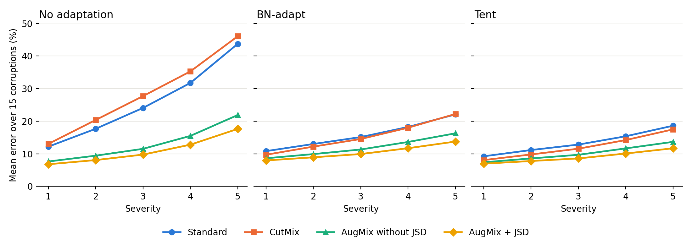

# Final Report Draft: Stage 1 (Training)

**Author:** Kirtan Patel (Member 1)
**Status:** Draft of the Stage 1 part of the final report.

---

## Training the Models

In Stage 1 we train the models that Stage 2 tests. Every model uses the same network and the same training settings. Only the training pictures and the loss change, so any difference comes from the training method.

### Data

We train on the 50,000 CIFAR-10 training pictures [1]. Each picture is 32x32 and belongs to 1 of 10 classes. We check clean accuracy on the 10,000 CIFAR-10 test pictures. We only use the test accuracy to report results, not to pick a model. Each saved model is the model from the last epoch. We do not use CIFAR-10-C [2] in Stage 1.

### Model

We use ResNet-18 [3], the version made for 32x32 pictures. It has about 11 million parameters and a batch normalization (BN) layer after each convolution. BN-adapt and Tent both need these BN layers. The model takes pictures with values from 0 to 1 and normalizes them inside, so Stage 2 can use it directly.

### Training Methods

All methods use random crop (padding 4) and random horizontal flip.

| Method | What it does | Loss |
|---|---|---|
| Standard | Crop and flip only | Cross-entropy |
| CutMix [4] | Pastes a box from one picture onto another and mixes the labels by area | Cross-entropy |
| AugMix without JSD [5] | Trains on one AugMix picture for each image | Cross-entropy |
| AugMix + JSD [5] | Uses the clean picture and 2 AugMix pictures, and asks the model to give the same answer for all 3 | Cross-entropy + 12 x JSD |

To make an AugMix picture, we make 3 edited copies. Each copy gets 1 to 3 random edits at severity 3. We mix the copies together, then mix the result with the original picture.

**Keeping the test fair.** The model must not train on the same changes it is tested on. So we use only 9 edits: autocontrast, equalize, posterize, rotate, solarize, shear x, shear y, translate x and translate y. We do not use brightness, contrast, color or sharpness, and a unit test checks this.

### Training Settings

| Setting | Value |
|---|---|
| Epochs | 100 |
| Batch size | 128 |
| Optimizer | SGD, momentum 0.9, Nesterov |
| Learning rate | 0.1 with cosine decay |
| Weight decay | 0.0005 |
| Precision | Mixed precision (FP16) |
| CutMix | alpha = 1.0 |
| AugMix | 3 copies, 1–3 edits, severity 3, JSD weight 12 |

These are the AugMix default settings. We did not tune them for each method. We trained 6 models: 2 seeds for Standard, 2 seeds for AugMix + JSD, and 1 seed each for CutMix and AugMix without JSD.

### Clean Results

| Model | Seed | Clean accuracy | Clean error | Seconds per epoch | GPU hours | Where |
|---|---|---|---|---|---|---|
| Standard | 1 | 95.08% | 4.92% | 23.37 | 0.649 | Colab T4 |
| Standard | 2 | 94.97% | 5.03% | 20.84 | 0.579 | Colab T4 |
| AugMix + JSD | 1 | 95.21% | 4.79% | 141.58 | 3.933 | Colab T4, then Kaggle T4 |
| AugMix + JSD | 2 | 95.29% | 4.71% | 80.65 | 2.240 | Kaggle T4 |
| AugMix without JSD | 1 | 95.31% | 4.69% | 40.63 | 1.129 | Kaggle T4 |
| CutMix | 1 | 96.18% | 3.82% | 18.66 | 0.518 | Kaggle T4 |

All models reach about 95–96% clean accuracy. The two seeds are close: they differ by 0.11 points for Standard and 0.08 points for AugMix + JSD. CutMix is the best on clean pictures.

Stage 2 got the same clean error for 5 of the 6 models. AugMix + JSD seed 2 differs by one test picture (4.72% vs 4.71%). This shows the models were passed to Stage 2 correctly.

### Corruption Results

This table shows the mean error over the 75 CIFAR-10-C conditions, using the episodic test with batch size 200. Standard and AugMix + JSD are the mean of 2 seeds.

| Model | Clean error, no adaptation | No adaptation | BN-adapt | Tent |
|---|---|---|---|---|
| Standard | 4.98% | 25.88% | 15.85% | 13.43% |
| CutMix | 3.82% | 28.50% | 15.33% | 12.22% |
| AugMix without JSD | 4.69% | 13.19% | 11.95% | 10.19% |
| AugMix + JSD | 4.76% | 11.01% | 10.45% | 9.01% |

**RQ1 and H1: which training method is best on corruptions?** AugMix + JSD has the lowest error, so H1 is supported. Both of its seeds (10.84% and 11.17%) beat every other model. CutMix is the best on clean pictures, but it is 2.61 points worse than Standard on corruptions.

**RQ2 and H2: how much does JSD help?** Removing JSD adds 2.18 points of error, which is close to the 2 points we expected. So H2 is supported, but AugMix without JSD has only 1 seed. Compared with Standard, AugMix + JSD lowers the error by 14.88 points. About 12.70 points come from the augmentation and 2.18 points come from JSD.

**Severity curves.** Without adaptation, the error of Standard and CutMix grows quickly as severity goes up. At severity 5, Standard has 43.74% error and AugMix + JSD has 17.64%. Adaptation makes the curves much flatter. At severity 1, adaptation makes AugMix + JSD a little worse (6.78% with no adaptation, 7.95% with BN-adapt and 6.96% with Tent). Tent helps it from severity 2, and BN-adapt helps it from severity 4.

**H5: which corruptions stay hard?** H5 is partly supported. Glass blur and noise stay among the hardest, but JPEG compression also joins the 5 hardest after adaptation. Contrast gets much easier for Standard (23.5% to 9.9% with BN-adapt). Fog improves less (11.4% to 9.4%), and BN-adapt makes fog slightly worse for AugMix + JSD (8.4% to 8.8%).

### Training Cost

All 6 runs took about 9.05 GPU hours on T4 GPUs, plus about 0.2 hours for timing runs. This is inside the 6–11 hours we planned. The two AugMix + JSD runs used 6.17 hours, which is 68% of the total.

| Method | Colab, 2 CPU workers (s/epoch) | Kaggle, 4 CPU workers (s/epoch) |
|---|---|---|
| Standard | 21.0 | Not run |
| CutMix | 23.0 | 18.66 |
| AugMix without JSD | 91.0 | 40.63 |
| AugMix + JSD | 180.6 | 80.65 |

On Colab, AugMix + JSD took about 8.6 times longer per epoch than Standard. AugMix is slow because the pictures are edited on the CPU. With 4 CPU workers instead of 2, both AugMix versions ran about 2.2 times faster. Because of this, GPU hours from Colab and Kaggle should not be compared directly.

### Problems We Fixed

- **JSD loss gave `nan`.** It took the log of 0 in some cases. We rewrote it in a safe way and added a test.
- **Training stopped.** Free GPU sessions can stop at any time, so `train.py` saves every 5 epochs and continues on its own. AugMix + JSD seed 1 stopped on Colab at epoch 86, so we continued it on Kaggle from epoch 85.
- **Layer names did not match Stage 2.** We renamed them, so Stage 2 can load the models directly.

### Limitations

- CutMix and AugMix without JSD have only 1 seed, so those results are less certain.
- We used one network, one dataset and one set of settings, and we did not tune them for each method.
- CutMix can need more epochs, so its result at 100 epochs may be a little low.
- The runs cannot be repeated exactly. Checkpoints do not save the random state, and we used two platforms.

### References

[1] A. Krizhevsky, "Learning Multiple Layers of Features from Tiny Images," Technical Report, University of Toronto, 2009.

[2] D. Hendrycks and T. Dietterich, "Benchmarking Neural Network Robustness to Common Corruptions and Perturbations," ICLR, 2019.

[3] K. He, X. Zhang, S. Ren, and J. Sun, "Deep Residual Learning for Image Recognition," CVPR, 2016.

[4] S. Yun, D. Han, S. J. Oh, S. Chun, J. Choe, and Y. Yoo, "CutMix: Regularization Strategy to Train Strong Classifiers with Localizable Features," ICCV, 2019.

[5] D. Hendrycks, N. Mu, E. D. Cubuk, B. Zoph, J. Gilmer, and B. Lakshminarayanan, "AugMix: A Simple Data Processing Method to Improve Robustness and Uncertainty," ICLR, 2020.
